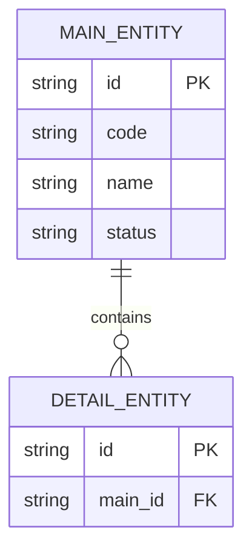
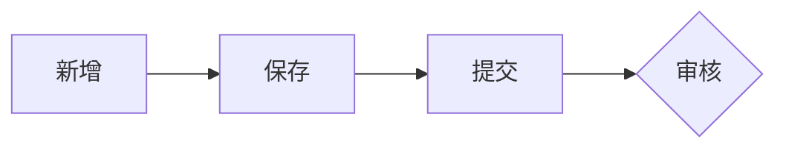

# 功能设计文档模板

本文档提供YonBIP制造云功能设计文档的标准结构和内容模板。

## 文档结构

### 1. 文档信息

```markdown
## 文档信息

| 属性 | 内容 |
|-----|------|
| 文档编号 | {编号，如 MFG-SFC-001} |
| 版本号 | V1.0 |
| 创建日期 | {YYYY-MM-DD} |
| 作者 | {姓名} |
| 模块名称 | {模块名，如 车间管理} |
```

### 2. 需求关联

```markdown
## 一、需求关联

| 需求文档 | 所属章节 | 需求标题 | 需求链接 |
|---------|---------|---------|---------|
| {需求文档名称} | {章节} | {标题} | {链接路径} |

### 相关资料

| 资料类型 | 资料名称 | 链接 |
|---------|---------|-----|
| 需求文档 | {名称} | {云文档链接} |
```

### 3. 功能描述

```markdown
## 二、功能描述

### 2.1 目的

{功能目的描述}

### 2.2 功能背景

**设计原则**:
- 原则:以现有mdd框架为基础，元数据/DDL命名符合BIP及制造云规范，数据库采用逻辑删除

**业务痛点**:
- 痛点1: {痛点描述}
- 痛点2: {痛点描述}

**预期效果**:
- 效果: {效果描述}

### 2.3 功能范围

| 范围项 | 是否包含 | 说明 |
|-------|---------|-----|
| 新增 | Y/N | {说明} |
| 编辑 | Y/N | {说明} |
| 删除 | Y/N | {说明} |
| 查询 | Y/N | {说明} |
| 导入 | Y/N | {说明} |
| 导出 | Y/N | {说明} |
| 复制 | Y/N | {说明} |
| 审核 | Y/N | {说明} |
| 提交 | Y/N | {说明} |
```

### 4. 模块整体设计

```markdown
## 三、模块整体设计

### 3.1 模块信息

| 属性 | 内容 |
|-----|------|
| 模块名称 | {模块名} |
| 实体名称 | {实体名，如 sfc.xxx.Xxx} |
| 单据编号 | {编号，如 sfc_xxx_list、sfc_xxx} |
| 数据库表 | {表名，如 imp_sfc_xxx、imp_sfc_xxx_detail} |
| 能力描述 | {功能描述} |

### 3.2 模块关系

| 关联模块 | 关联方式 | 关联说明 |
|---------|---------|---------|
| 组织档案 | 被引用 | {说明} |
| 工程数据 | 被引用 | {说明} |
```

### 5. 业务对象设计

```markdown
## 四、业务对象设计

### 4.1 对象清单

| 对象名称 | 对象类型 | 数据库表名 | 说明 |
|---------|---------|----------|------|
| {entity} | MainEntity | {table} | 主表 |
| {entity}Detail | DetailEntity | {table}_detail | 明细表 |

### 4.2 对象关系图(ER图)



### 4.3 对象关系配置

| 关系类型 | 主对象 | 从对象 | 关联字段 | 关联类型 | 级联删除 |
|---------|-------|-------|---------|---------|---------|
| composition | {Entity} | {Entity}Detail | mainId | 1:N | 是 |

### 4.4 字段设计

#### 主表字段({Entity})

| 序号 | 字段名 | 字段标题 | 字段类型 | 基础类型 | 长度 | 必填 | 默认值 | 关联对象 | 列表显示 | 表单显示 | 查询条件 | 导入 | 导出 |
|-----|-------|---------|---------|---------|-----|-----|-------|---------|---------|---------|---------|-----|-----|
| 1 | id | 主键 | String | BaseTypeString | 32 | Y | - | - | N | N | N | N | N |
| 2 | code | 编码 | String | BaseTypeString | 50 | Y | 自动生成 | - | Y | Y(只读) | Y | Y | Y |

**字段类型映射**:

| 字段类型 | 基础类型 | Java类型 | 数据库类型 | 说明 |
|---------|---------|---------|----------|------|
| String | BaseTypeString | String | VARCHAR | 字符串 |
| Long | BaseTypeLong | Long | BIGINT | 长整型 |
| Decimal | BaseTypeDecimal | BigDecimal | DECIMAL(28,8) | 精确数值 |
| Date | BaseTypeDate | Date | DATE | 日期 |
| DateTime | BaseTypeDateTime | Date | DATETIME | 日期时间 |
| Boolean | BaseTypeBoolean | Boolean | TINYINT | 布尔 |
| Integer | BaseTypeInteger | Integer | INT | 整型 |
```

### 6. 页面设计

```markdown
## 五、页面设计

### 5.1 页面清单

| 单据编号 | 页面类型 | 说明 |
|-------|---------|-----|
| {billNum}_list | list | 列表页 |
| {billNum} | detail | 详情页 |
| {billNum} | form | 表单页 |

### 5.2 列表页设计

#### 过滤区配置

| 序号 | 过滤项 | 字段名 | 组件类型 | 数据源 | 默认值 | 必填 |
|-----|-------|-------|---------|-------|-------|-----|
| 1 | {名称} | {field} | Input/Select | {source} | {default} | N |

#### 表格列配置

| 序号 | 列名称 | 字段名 | 列宽 | 对齐方式 | 格式化 | 排序 | 链接 |
|-----|-------|-------|-----|---------|-------|-----|-----|
| 1 | {名称} | {field} | 150 | left | - | Y | Y |

#### 按钮配置

| 序号 | 按钮名称 | 按钮类型 | 图标 | 点击事件 | 显示条件 | 状态控制 | 权限编码 | 关联API |
|-----|---------|---------|------|---------|---------|---------|---------|---------|
| 1 | 新增 | primary | plus | handleAdd | 始终 | - | {entity}:add | POST /{entity} |

### 5.3 表单页设计

#### 表头字段配置

| 序号 | 字段名称 | 字段名 | 组件类型 | 必填 | 只读 | 默认值 | 校验规则 | 列宽占比 |
|-----|---------|-------|---------|-----|-----|-------|---------|---------|
| 1 | {名称} | {field} | Input | N | Y | {default} | - | 1/3 |

### 5.4 字段联动规则

| 触发字段 | 触发事件 | 联动字段 | 联动逻辑 |
|---------|---------|---------|---------|
| {field} | onChange | {target} | {逻辑描述} |
```

### 7. 接口设计

```markdown
## 六、接口设计

### 6.1 接口清单

| 接口ID | 接口名称 | 请求方式 | URL | 说明 |
|-------|---------|---------|-----|-----|
| API-001 | 查询列表 | POST | /api/{module}/{entity}/list | 分页查询 |
| API-002 | 查询详情 | GET | /api/{module}/{entity}/{id} | 根据ID查询 |
| API-003 | 新增 | POST | /api/{module}/{entity} | 新增单据 |
| API-004 | 修改 | PUT | /api/{module}/{entity} | 修改单据 |
| API-005 | 删除 | DELETE | /api/{module}/{entity}/{id} | 删除单据 |

### 6.2 接口详情

#### API-003: 新增单据

**请求**:
```json
{
  "orgId": "组织ID",
  "name": "名称",
  "details": []
}
```

**响应**:
```json
{
  "code": 200,
  "message": "操作成功",
  "data": {
    "id": "单据ID",
    "code": "单据编号"
  }
}
```
```

### 8. 后端业务设计

```markdown
## 七、后端业务设计

### 7.1 默认值赋值

| 字段 | 赋值时机 | 赋值规则 |
|-----|---------|---------|
| code | 新增时 | 根据编码规则自动生成 |
| status | 新增时 | 默认为10(新建) |
| orgId | 新增时 | 默认为当前用户组织 |

### 7.2 保存校验规则

| 校验项 | 校验规则 | 错误信息 | 校验时机 |
|-------|---------|---------|---------|
| {字段}必填 | field != null | {字段}不能为空 | BeforeSave |

### 7.3 Action动作设计

| Action名称 | Action类 | 触发条件 | 状态变更 | 调用方法 | 说明 |
|----------|---------|---------|---------|---------|-----|
| Submit | SubmitAction | status=10,25 | →20 | validateStatus | 提交 |
| Audit | AuditAction | status=20 | →30 | validateStatus | 审核 |

### 7.4 Rule规则设计

| 执行顺序 | Rule名称 | Rule类 | 触发时机 | 触发动作 | 调用方法 | 说明 |
|-----|---------|-------|---------|---------|---------|-----|
| 1 | {Entity}BeforeSaveCheckRule | BeforeSaveCheckRule | BeforeSave | Save | checkMainData | 保存前校验 |

### 7.5 方法设计

# MethodBegin:{方法名称}
#方法声明
方法编码:{module}.{entity}.{action}.{method}
功能:{功能描述}
*调用动作:{触发时机}
public {returnType} {methodName}(
//----入参说明
@NotNull {paramType} {paramName}, // {参数说明}
//----出参说明
@Valid {returnType} result // {返回说明}
) throws BizException {
#逻辑说明:
1. {步骤1}
2. {步骤2}
##错误码表
|错误码|触发场景|处理策略|
|-----|-------|--------|
```

### 9. 功能流程图

```markdown
## 八、功能流程图

### 8.1 单据生命周期


### 8.2 核心业务流程


```

### 10. 测试场景

```markdown
## 九、测试场景

### 9.1 功能测试场景

| 场景ID | 场景名称 | 前置条件 | 测试步骤 | 预期结果 | 优先级 |
|-------|---------|---------|---------|---------|--------|
| TC-001 | 正常新增 | 登录系统 | 1.点击新增<br>2.填写信息<br>3.保存 | 新增成功 | P0 |
```

### 11. 变更记录

```markdown
## 十、变更记录

| 版本 | 日期 | 变更内容 | 变更人 |
|-----|------|---------|-------|
| V1.0 | {日期} | 初始版本 | {姓名} |
```

### 12. 非功能设计

```markdown
## 十一、非功能设计

### 11.1 事件驱动架构设计

| 事件编码 | 事件名称 | 发布时机 | 事件载荷 |
|---------|---------|---------|---------|
| {entity}.created | 单据创建事件 | AfterSave | {"billId": "xxx"} |

### 11.2 并发控制

| 控制点 | 控制方式 | 实现方案 |
|--------|---------|---------|
| 单据修改 | 乐观锁 | version字段 |

### 11.3 OpenAPI设计

| 接口ID | 接口说明 | 路径 | 方法 |
|--------|---------|------|------|
| OPEN-001 | 同步创建 | /openapi/v1/{entity} | POST |

### 11.4 导入导出设计

| 功能 | 设计要点 | 技术实现 |
|------|---------|---------|
| 模板下载 | 标准Excel模板 | 服务端生成.xlsx |
| 数据导入 | 异步处理 | 消息队列 |

### 11.5 权限体系设计

| 权限类型 | 控制粒度 | 实现方式 |
|---------|---------|---------|
| 功能权限 | 菜单/按钮 | RBAC模型 |
| 数据权限 | 行级数据 | SQL过滤 |

### 11.6 编码规则设计

| 规则要素 | 说明 | 示例 |
|---------|------|------|
| 固定前缀 | 前缀字符 | PO |
| 日期变量 | {YYYYMMDD} | 20260407 |
| 序列号 | {SEQ:5} | 00001 |

### 11.7 全球化设计

| 层面 | 设计要点 | 实现方式 |
|------|---------|---------|
| 文本 | 多语言资源文件 | messages_*.properties |
| 时区 | UTC存储 | 前端转换 |
```

## 标准字段清单

所有设计文档必须包含以下基础字段：

### 主表必含字段

| 字段名 | 字段标题 | 类型 | 长度 | 说明 |
|-------|---------|-----|-----|------|
| id | 主键 | String | 32 | 主键ID |
| code | 编码 | String | 50 | 单据编号（自动生成） |
| name | 名称 | String | 200 | 单据名称 |
| orgId | 组织 | String | 32 | 所属组织 |
| deptId | 部门 | String | 32 | 所属部门 |
| status | 状态 | String | 20 | 单据状态 |
| memo | 备注 | String | 500 | 备注信息 |
| pubts | 时间戳 | DateTime | - | 乐观锁字段 |
| create_time | 创建时间 | DateTime | - | 创建时间 |
| create_user | 创建人 | String | 32 | 创建人ID |
| modify_time | 修改时间 | DateTime | - | 修改时间 |
| modify_user | 修改人 | String | 32 | 修改人ID |
| is_deleted | 删除标记 | Boolean | - | 逻辑删除标记 |

### 明细表必含字段

| 字段名 | 字段标题 | 类型 | 长度 | 说明 |
|-------|---------|-----|-----|------|
| id | 主键 | String | 32 | 行主键ID |
| mainId | 主表ID | String | 32 | 关联主表 |
| lineNo | 行号 | Decimal | 16,8 | 行号 |

## 状态定义标准

| 状态值 | 状态名称 | 说明 | 可执行操作 |
|-------|---------|------|-----------|
| 10 | 新建 | 单据新建状态 | 修改、删除、提交 |
| 20 | 已提交 | 已提交待审核 | 审核、驳回 |
| 25 | 已驳回 | 审核驳回 | 修改、删除、提交 |
| 30 | 已审核 | 审核通过 | 关闭 |
| 90 | 已关闭 | 单据关闭 | 无 |