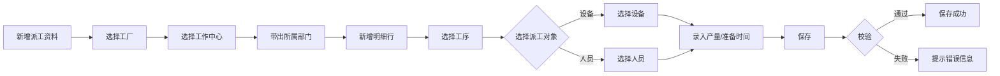
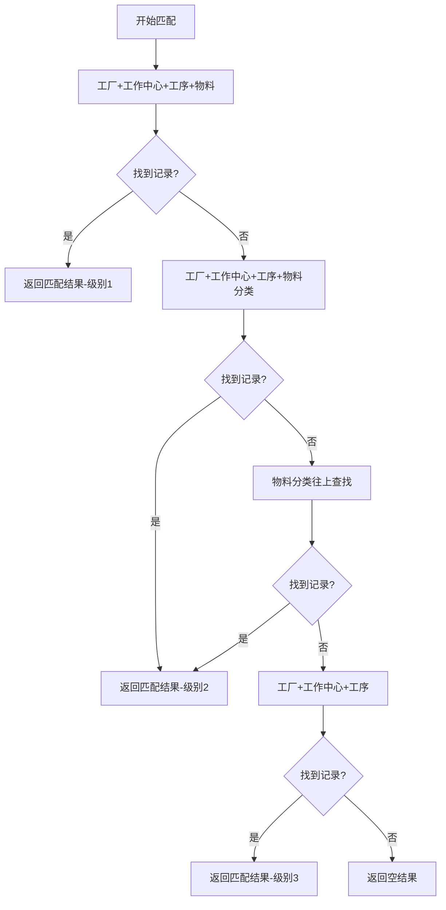

# 功能设计文档

## 文档信息

| 属性 | 内容 |
|-----|------|
| 文档编号 | MFG-SFC-AI-029 |
| 版本号 | V1.0 |
| 创建日期 | 2026-04-07 |
| 作者 | 刘超 |
| 模块名称 | 车间管理 |


---

## 一、需求关联

| 需求文档 | 所属章节 | 需求标题 | 需求链接 |
|---------|---------|---------|---------|
| MFG-SFC-01_生产制造-车间管理详细需求文档-车间任务及流转卡.md | 派工资料维护 | 派工资料维护 | docs/requirements/MFG-SFC-01_生产制造-车间管理详细需求文档-车间任务及流转卡.md##派工资料维护 |


### 相关资料

| 资料类型 | 资料名称 | 链接 |
|---------|---------|-----|
| 需求文档 | MFG-SFC-01_生产制造-车间管理详细需求文档-车间任务及流转卡.md | https://docs.yonyoucloud.com/l/966E7C0cAf45 【友空间云文档】MFG-SFC-01_生产制造-车间管理详细需求文档-车间任务及流转卡.md |

---

## 二、功能描述

### 2.1 目的

按工作中心维护派工时需要的设备、人员产能信息，为智能派工提供基础数据支撑。

### 2.2 功能背景

**设计原则**:
- 原则:以现有mdd框架为基础，元数据/DDL命名符合BIP及制造云规范，数据库采用逻辑删除

**业务痛点**:
- 痛点1: 派工时缺乏设备、人员产能基础数据，无法准确计算负荷
- 痛点2: 无法按工序、物料维度匹配派工资源

**预期效果**:
- 效果: 派工资料维护能够正常的新增、编辑、删除、查询、导入、导出、复制
- 效果: 为智能派工提供设备、人员产能匹配规则

### 2.3 功能范围

| 范围项 | 是否包含 | 说明 |
|-------|---------|-----|
| 新增 | Y | 点击新增按钮进入新增态页面，能够维护基本信息进行保存 |
| 编辑 | Y | 点击编辑按钮进入新增态页面，能够修改基本信息进行保存 |
| 删除 | Y | 点击删除按钮，能够正常删除已有数据 |
| 查询 | Y | 点击查询按钮，能够正常查询显示已有数据 |
| 导入 | Y | 点击导入工作台，能够导入数据 |
| 导出 | Y | 点击导出工作台，能够根据条件导出已有数据 |
| 复制 | Y | 可以复制已有信息，进行微调后保存 |
| 审核 | N | 不需要审核 |
| 提交 | N | 不需要审核 |

---

## 三、模块整体设计

### 3.1 模块信息

| 属性 | 内容 |
|-----|------|
| 模块名称 | 车间管理 |
| 实体名称 | 派工资料维护 |
| 单据编号 | sfc_disp_data_maint_list、sfc_disp_data_maint |
| 数据库表 | imp_sfc_disp_data_maint、imp_sfc_disp_data_maint_detail、imp_sfc_disp_data_maint_operator |
| 能力描述 | 按工作中心维护派工时需要的设备、人员产能信息，为智能派工提供基础数据 |


### 3.2 模块关系

| 关联模块 | 关联方式 | 关联说明 |
|---------|---------|---------|
| 组织档案 | 被引用 | 工厂 |
| 组织档案 | 被引用 | 部门 |
| 工程数据 | 被引用 | 工作中心（委外为否的启用状态） |
| 工程数据 | 被引用 | 标准工序（工厂及企业账号级已启用） |
| 资产卡片 | 被引用 | 设备（资产状态=在用） |
| 员工档案 | 被引用 | 人员（任职信息为当前组织） |
| 核心档案 | 被引用 | 物料（使用组织=工厂及企业账号级已启用） |
| 核心档案 | 被引用 | 物料分类（适用范围组织=工厂及企业账号级已启用） |
| 计量单位 | 被引用 | 主单位 |

---

## 四、业务对象设计

### 4.1 对象清单

| 对象名称 | 对象类型 | 数据库表名 | 说明 |
|---------|---------|----------|------|
| sfc.dispdatamaint.DispDataMaint | MainEntity | imp_sfc_disp_data_maint | 主表 |
| sfc.dispdatamaint.DispDataMaintDetail | DetailEntity | imp_sfc_disp_data_maint_detail | 明细表（派工资料明细） |
| sfc.dispdatamaint.DispDataMaintOperator | SubDetailEntity | imp_sfc_disp_data_maint_operator | 子明细表（可操作人员） |
| sfc.dispdatamaint.DispDataMaintSelfDefineCharacter | DefineCharacterEntity | imp_sfc_disp_data_maint_dct | 主表自定义项特征实体 |
| sfc.dispdatamaint.DispDataMaintDetailSelfDefineCharacter | DefineCharacterEntity | imp_sfc_disp_data_maint_detail_dct | 明细表自定义项特征实体 |
| sfc.dispdatamaint.DispDataMaintOperatorSelfDefineCharacter | DefineCharacterEntity | imp_sfc_disp_data_maint_operator_dct | 子明细表自定义项特征实体 |

### 4.2 对象关系图(ER图)

```mermaid
erDiagram
    DISP_DATA_MAINT {
        long id PK
        string code "编码"
        string ytenant_id "平台租户ID"
        string org_id FK "工厂ID"
        long work_center_id FK "工作中心ID"
        string dept_id FK "所属部门ID"
        string remark "备注"
        datetime create_time "创建时间"
        date create_date "创建日期"
        datetime modify_time "修改时间"
        date modify_date "修改日期"
        string creator "创建人"
        string modifier "修改人"
        long creator_id "创建人ID"
        long modifier_id "修改人ID"
        datetime pubts "系统时间戳"
        string self_define_character FK "自定义项特征"
    }

    DISP_DATA_MAINT_DETAIL {
        long id PK
        long main_id FK
        string ytenant_id "平台租户ID"
        decimal line_no "行号"
        long std_process_id FK "标准工序ID"
        long product_class_id FK "物料分类ID"
        long product_id FK "物料ID"
        string disp_obj_type "派工对象类别"
        string equip_id FK "设备ID"
        string staff_id FK "人员ID"
        decimal output_qty "产量"
        string unit_id FK "主单位ID"
        decimal prep_time "准备时间"
        long time_unit "时间单位"
        integer priority "优先级"
        datetime pubts "系统时间戳"
        string self_define_character FK "自定义项特征"
    }

    DISP_DATA_MAINT_OPERATOR {
        long id PK
        long detail_id FK
        string ytenant_id "平台租户ID"
        decimal line_no "行号"
        string staff_id FK "人员ID"
        datetime pubts "系统时间戳"
        string self_define_character FK "自定义项特征"
    }

    DISP_DATA_MAINT_SELF_DEFINE_CHARACTER {
        string id PK
        string ytenant_id "平台租户ID"
        datetime pubts "系统时间戳"
    }

    DISP_DATA_MAINT_DETAIL_SELF_DEFINE_CHARACTER {
        string id PK
        string ytenant_id "平台租户ID"
        datetime pubts "系统时间戳"
    }

    DISP_DATA_MAINT_OPERATOR_SELF_DEFINE_CHARACTER {
        string id PK
        string ytenant_id "平台租户ID"
        datetime pubts "系统时间戳"
    }

    DISP_DATA_MAINT ||--1{ DISP_DATA_MAINT_DETAIL : contains
    DISP_DATA_MAINT_DETAIL ||--o{ DISP_DATA_MAINT_OPERATOR : contains
    DISP_DATA_MAINT ||--o| DISP_DATA_MAINT_SELF_DEFINE_CHARACTER : "自定义项特征"
    DISP_DATA_MAINT_DETAIL ||--o| DISP_DATA_MAINT_DETAIL_SELF_DEFINE_CHARACTER : "自定义项特征"
    DISP_DATA_MAINT_OPERATOR ||--o| DISP_DATA_MAINT_OPERATOR_SELF_DEFINE_CHARACTER : "自定义项特征"
```

### 4.3 对象关系配置

| 关系类型 | 主对象 | 从对象 | 关联字段 | 关联类型 | 级联删除 |
|---------|-------|-------|---------|---------|---------|
| composition | DispDataMaint | DispDataMaintDetail | mainId | 1:1..N | 是 |
| composition | DispDataMaintDetail | DispDataMaintOperator | detailId | 1:0..N | 是 |
| composition | DispDataMaint | DispDataMaintSelfDefineCharacter | selfDefineCharacter | 1:1 | 是 |
| composition | DispDataMaintDetail | DispDataMaintDetailSelfDefineCharacter | selfDefineCharacter | 1:1 | 是 |
| composition | DispDataMaintOperator | DispDataMaintOperatorSelfDefineCharacter | selfDefineCharacter | 1:1 | 是 |

### 4.4 继承关系配置

| 父类 | 子类 | 继承类型 | 说明 |
|---------|-------|---------|---------|
| voucher.base.Vouch | DispDataMaint | generalization | 主表继承单据基类 |
| voucher.base.VouchLine | DispDataMaintDetail | generalization | 明细表继承单据行基类 |
| voucher.base.VouchLine | DispDataMaintOperator | generalization | 子明细表继承单据行基类 |
| ucfbase.entity.BizObject | DispDataMaintSelfDefineCharacter | generalization | 主表自定义项特征继承基类 |
| ucfbase.entity.BizObject | DispDataMaintDetailSelfDefineCharacter | generalization | 明细表自定义项特征继承基类 |
| ucfbase.entity.BizObject | DispDataMaintOperatorSelfDefineCharacter | generalization | 子明细表自定义项特征继承基类 |

### 4.5 接口实现配置

| 实体类 | 实现接口 | 说明 |
|---------|---------|---------|
| DispDataMaint | ucfbase.ucfbaseItf.IYTenant | 租户接口 |
| DispDataMaint | ucfbase.ucfbaseItf.LogicDelete | 逻辑删除接口 |
| DispDataMaint | base.itf.IAuditInfo | 审计信息接口 |
| DispDataMaintDetail | ucfbase.ucfbaseItf.IYTenant | 租户接口 |
| DispDataMaintDetail | ucfbase.ucfbaseItf.LogicDelete | 逻辑删除接口 |
| DispDataMaintDetail | base.itf.ILineNo | 行号接口 |
| DispDataMaintOperator | ucfbase.ucfbaseItf.IYTenant | 租户接口 |
| DispDataMaintOperator | ucfbase.ucfbaseItf.LogicDelete | 逻辑删除接口 |
| DispDataMaintOperator | base.itf.ILineNo | 行号接口 |
| DispDataMaintSelfDefineCharacter | ucfbase.ucfbaseItf.IYTenant | 租户接口 |
| DispDataMaintSelfDefineCharacter | ucfbase.ucfbaseItf.LogicDelete | 逻辑删除接口 |
| DispDataMaintSelfDefineCharacter | ucfbase.character.ICharacteristcs | 特征接口 |
| DispDataMaintDetailSelfDefineCharacter | ucfbase.ucfbaseItf.IYTenant | 租户接口 |
| DispDataMaintDetailSelfDefineCharacter | ucfbase.ucfbaseItf.LogicDelete | 逻辑删除接口 |
| DispDataMaintDetailSelfDefineCharacter | ucfbase.character.ICharacteristcs | 特征接口 |
| DispDataMaintOperatorSelfDefineCharacter | ucfbase.ucfbaseItf.IYTenant | 租户接口 |
| DispDataMaintOperatorSelfDefineCharacter | ucfbase.ucfbaseItf.LogicDelete | 逻辑删除接口 |
| DispDataMaintOperatorSelfDefineCharacter | ucfbase.character.ICharacteristcs | 特征接口 |

### 4.6 字段设计

#### 4.6.1 主表字段(DispDataMaint)

| 序号 | 字段名 | 字段标题 | 字段类型 | 基础类型 | 长度 | 必填 | 默认值 | 参照类型 | 数据权限 | 列表显示 | 表单显示 | 查询条件 | 导入 | 导出 |
|-----|-------|---------|---------|---------|-----|-----|-------|---------|---------|---------|---------|---------|-----|-----|
| 1 | id | 主键 | Long | BaseTypeLong | 20 | Y | - | - | - | N | N | N | N | N |
| 2 | code | 编码 | String | BaseTypeString | 50 | Y | 编码规则生成 | - | - | Y | Y | Y | Y | Y |
| 3 | ytenantId | 平台租户ID | String | BaseTypeString | 36 | Y | 当前租户 | - | - | N | N | N | N | N |
| 4 | orgId | 工厂 | org.func.BaseOrg | BaseTypeRef | - | Y | - | ucf-org-center.bd_factoryorg | - | Y | Y | Y | Y | Y |
| 5 | workCenterId | 工作中心 | ed.workcenter.WorkCenter | BaseTypeRef | - | Y | - | engineeringdata.ed_workcenter_ref | Y | Y | Y | Y | Y |
| 6 | deptId | 所属部门 | aa.baseorg.DeptMV | BaseTypeRef | - | N | 按工作中心带出 | ucf-org-center.bd_adminorgsharetreeref | Y | Y | N | N | Y | Y |
| 7 | remark | 备注 | String | BaseTypeString | 512 | N | - | - | - | N | Y | N | Y | Y |
| 8 | createTime | 创建时间 | DateTime | BaseTypeDateTime | - | N | 系统时间 | - | - | Y | N | N | N | Y |
| 9 | createDate | 创建日期 | Date | BaseTypeDate | - | N | 系统日期 | - | - | N | N | N | N | N |
| 10 | modifyTime | 修改时间 | DateTime | BaseTypeDateTime | - | N | - | - | - | N | N | N | N | Y |
| 11 | modifyDate | 修改日期 | Date | BaseTypeDate | - | N | - | - | - | N | N | N | N | N |
| 12 | creator | 创建人 | String | BaseTypeString | 255 | N | 当前用户名称 | - | - | Y | N | N | N | Y |
| 13 | modifier | 修改人 | String | BaseTypeString | 255 | N | - | - | - | N | N | N | N | Y |
| 14 | creatorId | 创建人ID | Long | BaseTypeLong | - | N | 当前用户ID | - | - | N | N | N | N | N |
| 15 | modifierId | 修改人ID | Long | BaseTypeLong | - | N | - | - | - | N | N | N | N | N |
| 16 | pubts | 版本时间戳 | DateTime | BaseTypeDateTime | - | N | 系统时间 | - | - | N | N | N | N | N |
| 17 | selfDefineCharacter | 自定义项特征 | sfc.dispdatamaint.DispDataMaintSelfDefineCharacter | - | - | N | - | - | - | N | N | N | N | N |

**字段类型映射**:

| 字段类型 | 基础类型 | Java类型 | 数据库类型 | 说明 |
|---------|---------|---------|----------|------|
| String | BaseTypeString | String | VARCHAR | 字符串 |
| Long | BaseTypeLong | Long | BIGINT | 长整型 |
| Decimal | BaseTypeDecimal | BigDecimal | DECIMAL(28,8) | 精确数值 |
| Date | BaseTypeDate | Date | DATE | 日期 |
| DateTime | BaseTypeDateTime | Date | DATETIME | 日期时间 |
| Boolean | BaseTypeBoolean | Boolean | TINYINT | 布尔 |
| Integer | BaseTypeInteger | Integer | INT | 整型 |

#### 4.6.2 明细表字段(DispDataMaintDetail)

| 序号 | 字段名 | 字段标题 | 字段类型 | 基础类型 | 长度/精度 | 必填 | 默认值 | 参照类型 | 数据权限 | 列表显示 | 表单显示 | 导入 | 导出 |
|-----|-------|---------|---------|---------|----------|-----|-------|---------|---------|---------|---------|-----|-----|
| 1 | id | 主键 | Long | BaseTypeLong | 20 | Y | - | - | - | N | N | N | N |
| 2 | mainId | 主表 | sfc.dispdatamaint.DispDataMaint | BaseTypeRef | - | Y | - | - | - | N | N | N | N |
| 3 | ytenantId | 平台租户ID | String | BaseTypeString | 36 | Y | 当前租户 | - | - | N | N | N | N |
| 4 | lineNo | 行号 | Decimal | BaseTypeDecimal | 28,8 | N | 自动 | - | - | Y | Y | N | Y |
| 5 | stdProcessId | 标准工序 | ed.operation.Operation | BaseTypeRef | - | Y | - | engineeringdata.ed_operation_ref | Y | Y | Y | Y | Y |
| 6 | productClassId | 物料分类 | pc.cls.ManagementClass | BaseTypeRef | - | N | - | - | - | Y | Y | Y | Y |
| 7 | productId | 物料 | pc.product.Product | BaseTypeRef | - | N | - | productcenter.productref | Y | Y | Y | Y | Y |
| 8 | productAuth | 物料权限 | pb.dataauth.ProductDataAuth | BaseTypeRef | - | N | - | - | - | N | N | N | N |
| 9 | dispObjType | 派工对象类别 | String | BaseTypeString | 20 | Y | 设备 | - | - | Y | Y | Y | Y |
| 10 | equipId | 设备 | aim.equip.EquipHeadVO | BaseTypeRef | - | N | - | ucf-amc-ambd.aim_equip_ref | - | Y | Y | Y | Y |
| 11 | staffId | 人员 | bd.staff.StaffNew | BaseTypeRef | - | N | - | ucf-staff-center.bd_staff_outer_ref | Y | Y | Y | Y | Y |
| 12 | outputQty | 产量 | Decimal | BaseTypeDecimal | 28,8 | N | - | - | - | Y | Y | Y | Y |
| 13 | unitId | 主单位 | pc.unit.Unit | BaseTypeRef | - | N | 物料带出 | productcenter.aa_productunit | - | Y | Y | Y | Y |
| 14 | prepTime | 准备时间 | Decimal | BaseTypeDecimal | 28,8 | N | - | - | - | Y | Y | Y | Y |
| 15 | timeUnit | 时间单位 | String | BaseTypeString | 20 | Y | 小时 | - | - | Y | Y | Y | Y |
| 16 | priority | 优先级 | Integer | BaseTypeInteger | - | N | - | - | - | N | Y | Y | Y |
| 17 | pubts | 版本时间戳 | DateTime | BaseTypeDateTime | - | N | 系统时间 | - | - | N | N | N | N |
| 18 | selfDefineCharacter | 自定义项特征 | sfc.dispdatamaint.DispDataMaintDetailSelfDefineCharacter | - | - | N | - | - | - | N | N | N | N |

#### 4.6.3 子明细表字段(DispDataMaintOperator - 可操作人员)

| 序号 | 字段名 | 字段标题 | 字段类型 | 基础类型 | 长度/精度 | 必填 | 默认值 | 参照类型 | 数据权限 | 列表显示 | 表单显示 | 导入 | 导出 |
|-----|-------|---------|---------|---------|----------|-----|-------|---------|---------|---------|---------|-----|-----|
| 1 | id | 主键 | Long | BaseTypeLong | 20 | Y | - | - | - | N | N | N | N |
| 2 | detailId | 明细表 | sfc.dispdatamaint.DispDataMaintDetail | BaseTypeRef | - | Y | - | - | - | N | N | N | N |
| 3 | ytenantId | 平台租户ID | String | BaseTypeString | 36 | Y | 当前租户 | - | - | N | N | N | N |
| 4 | lineNo | 行号 | Decimal | BaseTypeDecimal | 28,8 | N | 自动 | - | - | Y | Y | N | Y |
| 5 | staffId | 人员 | bd.staff.StaffNew | BaseTypeRef | - | N | - | ucf-staff-center.bd_staff_outer_ref | Y | Y | Y | Y | Y |
| 6 | pubts | 版本时间戳 | DateTime | BaseTypeDateTime | - | N | 系统时间 | - | - | N | N | N | N |
| 7 | selfDefineCharacter | 自定义项特征 | sfc.dispdatamaint.DispDataMaintOperatorSelfDefineCharacter | - | - | N | - | - | - | N | N | N | N |

#### 4.6.4 主表自定义项特征实体字段(DispDataMaintSelfDefineCharacter)

| 序号 | 字段名 | 字段标题 | 字段类型 | 基础类型 | 长度/精度 | 必填 | 默认值 | 参照类型 | 列表显示 | 表单显示 | 导入 | 导出 |
|-----|-------|---------|---------|---------|----------|-----|-------|---------|---------|---------|-----|-----|
| 1 | id | 主键 | String | BaseTypeString | 36 | Y | - | - | N | N | N | N |
| 2 | ytenantId | 平台租户ID | String | BaseTypeString | 36 | Y | 当前租户 | - | N | N | N | N |
| 3 | pubts | 版本时间戳 | DateTime | BaseTypeDateTime | - | N | 系统时间 | - | N | N | N | N |

#### 4.6.5 明细表自定义项特征实体字段(DispDataMaintDetailSelfDefineCharacter)

| 序号 | 字段名 | 字段标题 | 字段类型 | 基础类型 | 长度/精度 | 必填 | 默认值 | 参照类型 | 列表显示 | 表单显示 | 导入 | 导出 |
|-----|-------|---------|---------|---------|----------|-----|-------|---------|---------|---------|-----|-----|
| 1 | id | 主键 | String | BaseTypeString | 36 | Y | - | - | N | N | N | N |
| 2 | ytenantId | 平台租户ID | String | BaseTypeString | 36 | Y | 当前租户 | - | N | N | N | N |
| 3 | pubts | 版本时间戳 | DateTime | BaseTypeDateTime | - | N | 系统时间 | - | N | N | N | N |

#### 4.6.6 子明细表自定义项特征实体字段(DispDataMaintOperatorSelfDefineCharacter)

| 序号 | 字段名 | 字段标题 | 字段类型 | 基础类型 | 长度/精度 | 必填 | 默认值 | 参照类型 | 列表显示 | 表单显示 | 导入 | 导出 |
|-----|-------|---------|---------|---------|----------|-----|-------|---------|---------|---------|-----|-----|
| 1 | id | 主键 | String | BaseTypeString | 36 | Y | - | - | N | N | N | N |
| 2 | ytenantId | 平台租户ID | String | BaseTypeString | 36 | Y | 当前租户 | - | N | N | N | N |
| 3 | pubts | 版本时间戳 | DateTime | BaseTypeDateTime | - | N | 系统时间 | - | N | N | N | N |

#### 4.6.7 索引设计

为提升数据库查询性能，需对主子表、子孙表的关联外键字段创建独立索引。

| 序号 | 表名 | 索引名 | 索引字段 | 索引类型 | 说明 |
|-----|-----|-------|---------|---------|------|
| 1 | imp_sfc_disp_data_maint_detail | i_mainId | mainId | 非唯一索引 | 明细表关联主表外键索引，优化主子表关联查询 |
| 2 | imp_sfc_disp_data_maint_operator | i_detailId | detailId | 非唯一索引 | 子明细表关联明细表外键索引，优化子孙表关联查询 |

**索引设计说明**：
- 索引命名规则：索引名采用 `i_字段编码` 格式，多字段联合索引字段间用下划线分隔
- 主子表关联外键索引：明细表(imp_sfc_disp_data_maint_detail)的mainId字段关联主表主键，创建非唯一索引可加速按主表ID查询明细数据
- 子孙表关联外键索引：子明细表(imp_sfc_disp_data_maint_operator)的detailId字段关联明细表主键，创建非唯一索引可加速按明细表ID查询子明细数据
- 非唯一索引：外键字段允许重复值（一个主表记录可对应多个明细表记录，一个明细表记录可对应多个子明细表记录），因此使用非唯一索引

### 4.7 状态定义

**状态字段**: status

本功能为基础资料维护，无需状态流转。

| 状态值 | 状态名称 | 状态说明 | 可执行操作 |
|-------|---------|---------|-----------|
| 10 | 新建 | 单据新建状态 | 修改、删除 |

### 4.8 枚举定义

| 枚举名称 | 枚举值 | 枚举说明 |
|---------|-------|---------|
| DispObjType | equip | 设备 |
| DispObjType | person | 人员 |
| TimeUnit | hour | 小时 |

### 4.9 数据权限配置

#### 4.9.1 数据权限字段清单

| 实体 | 字段名 | 字段标题 | 数据权限类型 | 数据权限授权属性 | 说明 |
|-----|-------|---------|-------------|-----------------|------|
| DispDataMaint | workCenterId | 工作中心 | ed.workcenter.WorkCenter | - | 工作中心数据权限 |
| DispDataMaint | deptId | 所属部门 | bd.adminOrg.AdminOrgVO | - | 部门数据权限 |
| DispDataMaintDetail | stdProcessId | 标准工序 | ed.operation.Operation | - | 标准工序数据权限 |
| DispDataMaintDetail | productId | 物料 | pc.product.Product | productAuth | 物料数据权限 |
| DispDataMaintDetail | staffId | 人员 | bd.staff.StaffNew | - | 人员数据权限 |
| DispDataMaintOperator | staffId | 人员 | bd.staff.StaffNew | - | 人员数据权限 |

#### 4.9.2 数据权限配置说明

| 配置项 | XML属性 | 说明 |
|-------|---------|------|
| 数据权限标识 | dataPowerFlag="true" | 标识字段启用数据权限控制 |
| 数据权限授权 | dataAuth="true" | 标识字段需要数据授权 |
| 数据权限类型 | dataPowerType | 指定数据权限类型实体 |
| 数据权限授权属性 | dataPowerAuthAttribute | 指定数据权限授权属性字段 |

#### 4.9.3 物料数据权限特殊配置

物料字段(productId)需要配置数据权限授权属性，用于记录用户对物料的操作权限：

```xml
<attribute title="物料" name="productId" columnName="product_id"
    type="pc.product.Product"
    dataPowerFlag="true"
    dataPowerAuthAttribute="productAuth"
    refType="productcenter.productref"/>
<attribute title="物料权限" name="productAuth" columnName="product_id"
    type="pb.dataauth.ProductDataAuth"
    mode="None"
    isRequired="true"/>
```

---

## 五、页面设计

### 5.1 页面清单

| 单据编号 | 页面类型 | 说明 |
|-------|---------|-----|
| sfc_disp_data_maint_list | list | 列表页 |
| sfc_disp_data_maint | detail | 详情页 |

### 5.2 列表页设计

#### 5.2.1 过滤区配置

| 序号 | 过滤项 | 字段名 | 组件类型 | 数据源 | 默认值 | 必填 |
|-----|-------|-------|---------|-------|-------|-----|
| 1 | 编码 | code | Input | - | - | N |
| 2 | 工厂 | orgId | Select | orgList | - | N |
| 3 | 工作中心 | workCenterId | MultiSelect | workCenterList | - | N |
| 4 | 工序 | stdProcessCode | MultiSelect | stdProcessList | - | N |
| 5 | 物料分类 | productClassCode | MultiSelect | productClassList | - | N |
| 6 | 物料 | productCode | MultiSelect | productList | - | N |
| 7 | 派工对象类别 | dispObjType | Select | dispObjTypeList | - | N |
| 8 | 设备 | equipCode | MultiSelect | equipList | - | N |
| 9 | 人员 | staffCode | MultiSelect | staffList | - | N |

#### 5.2.2 表格列配置

| 序号 | 列名称 | 字段名 | 列宽 | 对齐方式 | 格式化 | 排序 | 链接 | 是否显示 |
|-----|-------|-------|-----|---------|-------|-----|-----|---------|
| 1 | 主表ID | id | 100 | left | - | N | N | N |
| 2 | 编码 | code | 120 | left | - | Y | N | Y |
| 3 | 工厂ID | orgId | 100 | left | - | N | N | N |
| 4 | 工厂编码 | orgCode | 120 | left | - | Y | N | Y |
| 5 | 工厂名称 | orgName | 150 | left | - | N | N | Y |
| 6 | 工作中心ID | workCenterId | 100 | left | - | N | N | N |
| 7 | 工作中心编码 | workCenterCode | 120 | left | - | Y | N | Y |
| 8 | 工作中心名称 | workCenterName | 150 | left | - | N | N | Y |
| 9 | 部门ID | deptId | 100 | left | - | N | N | N |
| 10 | 部门编码 | deptCode | 120 | left | - | N | N | Y |
| 11 | 部门名称 | deptName | 150 | left | - | N | N | Y |
| 12 | 备注 | remark | 200 | left | - | N | N | Y |
| 13 | 创建时间 | createTime | 160 | center | datetime | Y | N | Y |
| 14 | 明细表ID | detailId | 100 | left | - | N | N | N |
| 15 | 行号 | lineNo | 80 | center | - | N | N | Y |
| 16 | 标准工序ID | stdProcessId | 100 | left | - | N | N | N |
| 17 | 工序编码 | stdProcessCode | 120 | left | - | Y | N | Y |
| 18 | 工序名称 | stdProcessName | 150 | left | - | N | N | Y |
| 19 | 物料分类ID | productClassId | 100 | left | - | N | N | N |
| 20 | 物料分类编码 | productClassCode | 120 | left | - | N | N | Y |
| 21 | 物料分类名称 | productClassName | 150 | left | - | N | N | Y |
| 22 | 物料ID | productId | 100 | left | - | N | N | N |
| 23 | 物料编码 | productCode | 120 | left | - | Y | N | Y |
| 24 | 物料名称 | productName | 150 | left | - | N | N | Y |
| 25 | 派工对象类别 | dispObjType | 100 | center | - | N | N | Y |
| 26 | 设备ID | equipId | 100 | left | - | N | N | N |
| 27 | 设备编码 | equipCode | 120 | left | - | N | N | Y |
| 28 | 设备名称 | equipName | 150 | left | - | N | N | Y |
| 29 | 人员ID | staffId | 100 | left | - | N | N | N |
| 30 | 人员编码 | staffCode | 120 | left | - | N | N | Y |
| 31 | 人员名称 | staffName | 150 | left | - | N | N | Y |
| 32 | 产量 | outputQty | 100 | right | decimal | N | N | Y |
| 33 | 主单位ID | unitId | 100 | left | - | N | N | N |
| 34 | 主单位编码 | unitCode | 80 | left | - | N | N | Y |
| 35 | 主单位名称 | unitName | 80 | left | - | N | N | Y |
| 36 | 准备时间 | prepTime | 100 | right | decimal | N | N | Y |
| 37 | 时间单位 | timeUnit | 100 | center | - | N | N | Y |
| 38 | 优先级 | priority | 80 | center | - | N | N | Y |
| 39 | 主表自定义项特征 | selfDefineCharacter | 150 | left | - | N | N | Y |
| 40 | 子表自定义项特征 | detailSelfDefineCharacter | 150 | left | - | N | N | Y |

#### 5.2.3 按钮配置

**表头按钮**

| 序号 | 按钮编码 | 按钮名称 | 按钮类型 | 点击事件 | action | 父级按钮 | 排序 | 权限编码 | 显示时机 |
|-----|---------|---------|---------|---------|--------|---------|-----|---------|---------|
| 1 | btnAdd | 新增 | primarybutton | cmdAdd | add | - | 100 | sfc_disp_data_maint_list_add | 始终 |
| 2 | btnSpliterAdd | - | spliter | - | - | - | 110 | - | 始终 |
| 3 | btnBatchDelete | 删除 | button | cmdBatchDelete | delete | - | 200 | sfc_disp_data_maint_list_delete | 始终 |
| 4 | btnImportGroup | 导入 | dropdownbutton | - | - | - | 300 | sfc_disp_data_maint_list_import | 始终 |
| 5 | btnImport | 导入 | button | cmdImport | import | btnImportGroup | 310 | sfc_disp_data_maint_list_import | 始终 |
| 6 | btnDownloadTemplate | 下载模板 | button | cmdDownloadTemplate | - | btnImportGroup | 320 | sfc_disp_data_maint_list_import | 始终 |
| 7 | btnSpliterImport | - | spliter | - | - | - | 400 | - | 始终 |
| 8 | btnExport | 导出 | button | cmdExport | export | - | 500 | sfc_disp_data_maint_list_export | 始终 |

**行内按钮**

| 序号 | 按钮编码 | 按钮名称 | 按钮类型 | 点击事件 | action | 父级按钮 | 排序 | 权限编码 | 显示时机 |
|-----|---------|---------|---------|---------|--------|---------|-----|---------|---------|
| 1 | btnEdit | 编辑 | button | cmdEdit | edit | - | 100 | sfc_disp_data_maint_list_edit | 始终 |
| 2 | btnCopy | 复制 | button | cmdCopy | copy | - | 200 | sfc_disp_data_maint_list_copy | 始终 |
| 3 | btnDelete | 删除 | button | cmdDelete | delete | - | 300 | sfc_disp_data_maint_list_delete | 始终 |

#### 5.2.4 列表排序规则

按主表id倒序、子表行号正序排列。

### 5.3 卡片浏览页设计

#### 5.3.1 按钮配置

| 区域 | 按钮编码 | 按钮名称 | action | 权限编码 | 显示时机 |
| --- | --- | --- | --- | --- | --- |
| 右上角 | btnAdd | 新增 | add | sfc_disp_data_maint_list_add | 浏览态 |
| 右上角 | btnEdit | 编辑 | edit | sfc_disp_data_maint_list_edit | 浏览态 |
| 右上角 | btnCopy | 复制 | copy | sfc_disp_data_maint_list_copy | 浏览态 |
| 右上角 | btnDelete | 删除 | delete | sfc_disp_data_maint_list_delete | 浏览态 |
| 右上角 | btnCancel | 取消 | abandon | - | 非浏览态 |
| 右上角 | btnSave | 保存 | save | sfc_disp_data_maint_list_save | 非浏览态 |

### 5.4 卡片编辑页设计

#### 5.4.1 表头字段配置

| 序号 | 字段名称 | 字段名 | 组件类型 | 必填 | 只读 | 默认值 | 校验规则 | 列宽占比 | 是否显示 |
|-----|---------|-------|---------|-----|-----|-------|---------|---------|---------|
| 1 | 主键 | id | Input | Y | Y | 自动生成 | - | 1/3 | N |
| 2 | 编码 | code | Input | Y | Y | 编码规则生成 | - | 1/3 | Y |
| 3 | 工厂ID | orgId | Input | Y | Y | - | - | 1/3 | N |
| 4 | 工厂编码 | orgCode | Select | Y | N | - | required | 1/3 | Y |
| 5 | 工厂名称 | orgName | Input | N | Y | 工厂带出 | - | 1/3 | Y |
| 6 | 工作中心ID | workCenterId | Input | Y | Y | - | - | 1/3 | N |
| 7 | 工作中心编码 | workCenterCode | Select | Y | N | - | required | 1/3 | Y |
| 8 | 工作中心名称 | workCenterName | Input | N | Y | 工作中心带出 | - | 1/3 | Y |
| 9 | 部门ID | deptId | Input | N | Y | 按工作中心带出 | - | 1/3 | N |
| 10 | 部门编码 | deptCode | Input | N | Y | 按工作中心带出 | - | 1/3 | Y |
| 11 | 部门名称 | deptName | Input | N | Y | 按工作中心带出 | - | 1/3 | Y |
| 12 | 备注 | remark | Textarea | N | N | - | max:512 | 100% | Y |
| 13 | 自定义项特征 | selfDefineCharacter | Input | N | N | - | - | 100% | Y |

#### 5.4.2 表体字段配置(派工资料明细)

| 序号 | 字段名称 | 字段名 | 组件类型 | 必填 | 只读 | 默认值 | 校验规则 | 列宽 | 是否显示 |
|-----|---------|-------|---------|-----|-----|-------|---------|-----|---------|
| 1 | 明细表ID | id | Input | Y | Y | 自动生成 | - | 60 | N |
| 2 | 行号 | lineNo | Input | N | Y | 自动 | - | 60 | Y |
| 3 | 标准工序ID | stdProcessId | Input | Y | Y | - | - | 60 | N |
| 4 | 工序编码 | stdProcessCode | Select | Y | N | - | required | 120 | Y |
| 5 | 工序名称 | stdProcessName | Input | N | Y | 工序带出 | - | 120 | Y |
| 6 | 物料分类ID | productClassId | Input | N | Y | - | - | 60 | N |
| 7 | 物料分类编码 | productClassCode | Select | N | N | - | - | 120 | Y |
| 8 | 物料分类名称 | productClassName | Input | N | Y | 物料分类带出 | - | 120 | Y |
| 9 | 物料ID | productId | Input | N | Y | - | - | 60 | N |
| 10 | 物料编码 | productCode | Select | N | N | - | - | 120 | Y |
| 11 | 物料名称 | productName | Input | N | Y | 物料带出 | - | 120 | Y |
| 12 | 规格说明 | productSpec | Input | N | Y | 物料带出 | - | 100 | Y |
| 13 | 型号 | productModel | Input | N | Y | 物料带出 | - | 100 | Y |
| 14 | 派工对象类别 | dispObjType | Select | Y | N | 设备 | required | 100 | Y |
| 15 | 设备ID | equipId | Input | N | Y | - | - | 60 | N |
| 16 | 设备编码 | equipCode | Select | N | N | - | 派工对象=设备时显示 | 120 | Y |
| 17 | 设备名称 | equipName | Input | N | Y | 设备带出 | - | 120 | Y |
| 18 | 人员ID | staffId | Input | N | Y | - | - | 60 | N |
| 19 | 人员编码 | staffCode | Select | N | N | - | 派工对象=人员时必输 | 120 | Y |
| 20 | 人员名称 | staffName | Input | N | Y | 人员带出 | - | 120 | Y |
| 21 | 产量 | outputQty | InputNumber | N | N | - | precision:8 | 100 | Y |
| 22 | 主单位ID | unitId | Input | N | Y | - | - | 60 | N |
| 23 | 主单位编码 | unitCode | Input | N | Y | 物料带出 | - | 80 | Y |
| 24 | 主单位名称 | unitName | Input | N | Y | 物料带出 | - | 80 | Y |
| 25 | 准备时间 | prepTime | InputNumber | N | N | - | precision:8 | 100 | Y |
| 26 | 时间单位 | timeUnit | SelectTag | Y | N | 小时 | 固定小时 | 80 | Y |
| 27 | 优先级 | priority | InputNumber | N | N | - | min:0 | 80 | Y |
| 28 | 自定义项特征 | selfDefineCharacter | Input | N | N | - | - | 150 | Y |

#### 5.4.3 子明细表字段配置(可操作人员)

显示条件：派工对象类别=设备时可编辑

| 序号 | 字段名称 | 字段名 | 组件类型 | 必填 | 只读 | 默认值 | 校验规则 | 列宽 | 是否显示 |
|-----|---------|-------|---------|-----|-----|-------|---------|-----|---------|
| 1 | 孙表ID | id | Input | Y | Y | 自动生成 | - | 60 | N |
| 2 | 行号 | lineNo | Input | N | Y | 自动 | - | 60 | Y |
| 3 | 人员ID | staffId | Input | N | Y | - | - | 60 | N |
| 4 | 人员编码 | staffCode | Select | N | N | - | - | 120 | Y |
| 5 | 人员名称 | staffName | Input | N | Y | 人员带出 | - | 120 | Y |
| 6 | 自定义项特征 | selfDefineCharacter | Input | N | N | - | - | 150 | Y |

#### 5.4.4 卡片肩按钮配置

| 按钮编码 | 按钮名称 | action | 权限编码 | 说明 | 显示时机 |
| --- | --- | --- | --- | --- | --- |
| btnAddRow | 增行 | addRow | sfc_disp_data_maint_list_save | 新增明细行 | 非浏览态 |
| btnDeleteRows | 删除 | deleteRow | sfc_disp_data_maint_list_save | 删除选中明细行 | 非浏览态 |

#### 5.4.5 卡片行按钮配置

| 按钮编码 | 按钮名称 | action | 权限编码 | 说明 | 显示时机 |
| --- | --- | --- | --- | --- | --- |
| btnCopyRow | 复制行 | copyRow | sfc_disp_data_maint_list_save | 复制当前明细行 | 非浏览态 |
| btnInsertRow | 插行 | insertRow | sfc_disp_data_maint_list_save | 在当前行上方插入新行 | 非浏览态 |
| btnDeleteRow | 删行 | deleteRow | sfc_disp_data_maint_list_save | 删除当前明细行 | 非浏览态 |

#### 5.4.6 卡片底部按钮配置

| 按钮编码 | 按钮名称 | action | 权限编码 | 说明 | 显示时机 |
| --- | --- | --- | --- | --- | --- |
| btnCancel | 取消 | abandon | - | 取消编辑，返回列表页 | 非浏览态 |
| btnSave | 保存 | save | sfc_disp_data_maint_list_save | 保存当前编辑内容 | 非浏览态 |

### 5.5 字段联动规则

| 触发字段 | 触发事件 | 联动字段 | 联动逻辑 |
|---------|---------|---------|---------|
| orgId | onChange | workCenterCode | 参照过滤：工厂对应的工作中心（委外=否，启用状态） |
| workCenterCode | onChange | deptCode | 按工作中心带出所属部门，不可编辑 |
| stdProcessCode | onChange | stdProcessName | 带出工序名称 |
| productClassCode | onChange | productClassName | 带出物料分类名称 |
| productCode | onChange | productName/productSpec/productModel/unitCode | 带出物料名称、规格说明、型号，如有值则带出主单位 |
| equipCode | onChange | equipName | 带出设备名称 |
| staffCode | onChange | staffName | 带出人员名称 |
| dispObjType | onChange | equipCode/staffCode显示控制 | 设备时显示设备字段，人员时显示人员字段且人员必输 |
| outputQty | onChange | - | Tips提示：按主单位，负荷计算时使用 |
| prepTime | onChange | - | Tips提示：按时间单位，负荷计算时使用 |

### 5.6 参照过滤规则

| 参照字段 | 过滤条件 |
|---------|---------|
| 工厂(orgId) | 用户有权限的工厂组织 |
| 工作中心(workCenterCode) | 工厂对应的工作中心，委外=否，启用状态 |
| 工序编码(stdProcessCode) | 工厂及企业账号级已启用的标准工序 |
| 物料分类编码(productClassCode) | 适用范围组织=工厂及企业账号级已启用的物料分类 |
| 物料编码(productCode) | 使用组织=工厂及企业账号级已启用的物料 |
| 设备编码(equipCode) | 工厂组织下资产状态=在用的资产卡片 |
| 人员编码(staffCode) | 任职信息为当前组织且系统当前时间在员工信息档案中兼职起始时间与结束时间之间的员工记录 |

---

## 六、接口设计

### 6.1 接口清单

#### 6.1.1 列表页接口(sfc_disp_data_maint_list)

| name | action | billnumber | target | ruleid | svcurl | httpmethod | subid | system | parameter | authid | description | microServiceCode |
|---------|--------|---------|-----|---------|-----|---------|------|------|---------|---------|-----|---------|
| cmdList | list | sfc_disp_data_maint_list | /bill/list | | IMPSFC | POST | 1 | | | sfc_disp_data_maint_list_query | 查询列表 | yonbip-mm-sfc |
| cmdAdd | add | sfc_disp_data_maint_list | /bill/add | | IMPSFC | GET | 1 | | | sfc_disp_data_maint_list_add | 新增 | yonbip-mm-sfc |
| cmdEdit | edit | sfc_disp_data_maint_list | /bill/edit | | IMPSFC | GET | 1 | | | sfc_disp_data_maint_list_edit | 编辑 | yonbip-mm-sfc |
| cmdDelete | delete | sfc_disp_data_maint_list | /bill/delete | | IMPSFC | POST | 1 | | | sfc_disp_data_maint_list_delete | 删除 | yonbip-mm-sfc |
| cmdBatchDelete | batchdelete | sfc_disp_data_maint_list | /bill/batchdelete | | IMPSFC | POST | 1 | | | sfc_disp_data_maint_list_delete | 批量删除 | yonbip-mm-sfc |
| cmdCopy | copy | sfc_disp_data_maint_list | /bill/copy | | IMPSFC | POST | 1 | | | sfc_disp_data_maint_list_copy | 复制 | yonbip-mm-sfc |
| cmdImport | import | sfc_disp_data_maint_list | /bill/billImport | | IMPSFC | POST | 1 | | | sfc_disp_data_maint_list_import | 导入 | yonbip-mm-sfc |
| cmdExport | export | sfc_disp_data_maint_list | /bill/export?action=output | | IMPSFC | POST | 1 | | | sfc_disp_data_maint_list_export | 导出 | yonbip-mm-sfc |
| CommonCommand | cominterface | sfc_disp_data_maint_list | /common | | IMPSFC | | 0 | | | sfc_disp_data_maint_list | cominterface | yonbip-mm-sfc |

#### 6.1.2 卡片页接口(sfc_disp_data_maint)

| name | action | billnumber | target | ruleid | svcurl | httpmethod | subid | system | parameter | authid | description | microServiceCode |
|---------|--------|---------|-----|---------|-----|---------|------|------|---------|---------|-----|---------|
| cmdDetail | detail | sfc_disp_data_maint | /bill/detail | | IMPSFC | GET | 1 | | | sfc_disp_data_maint_list_detail | 查询详情 | yonbip-mm-sfc |
| cmdAdd | add | sfc_disp_data_maint | /bill/add | | IMPSFC | GET | 1 | | | sfc_disp_data_maint_list_add | 新增 | yonbip-mm-sfc |
| cmdEdit | edit | sfc_disp_data_maint | /bill/edit | | IMPSFC | GET | 1 | | | sfc_disp_data_maint_list_edit | 编辑 | yonbip-mm-sfc |
| cmdSave | save | sfc_disp_data_maint | /bill/save | | IMPSFC | POST | 1 | | | sfc_disp_data_maint_list_save | 保存 | yonbip-mm-sfc |
| cmdDelete | delete | sfc_disp_data_maint | /bill/delete | | IMPSFC | POST | 1 | | | sfc_disp_data_maint_list_delete | 删除 | yonbip-mm-sfc |
| cmdCopy | copy | sfc_disp_data_maint | /bill/copy | | IMPSFC | POST | 1 | | | sfc_disp_data_maint_list_copy | 复制 | yonbip-mm-sfc |
| cmdAbandon | abandon | sfc_disp_data_maint | | | IMPSFC | GET | 1 | | | | 取消 | yonbip-mm-sfc |
| cmdMoveprev | moveprev | sfc_disp_data_maint | /bill/moveprev | | IMPSFC | GET | 1 | | | sfc_disp_data_maint_list_query | 上一条 | yonbip-mm-sfc |
| cmdMovenext | movenext | sfc_disp_data_maint | /bill/movenext | | IMPSFC | GET | 1 | | | sfc_disp_data_maint_list_query | 下一条 | yonbip-mm-sfc |
| cmdMatch | match | sfc_disp_data_maint | /bill/match | | IMPSFC | GET | 1 | | | | 匹配产能 | yonbip-mm-sfc |
| CommonCommand | cominterface | sfc_disp_data_maint | /common | | IMPSFC | | 0 | | | sfc_disp_data_maint_list | cominterface | yonbip-mm-sfc |

### 6.2 接口详情

#### API-005: 保存派工资料

**请求**:
```json
{
  "orgId": "工厂ID",
  "orgCode": "工厂编码",
  "orgName": "工厂名称",
  "workCenterId": "工作中心ID",
  "workCenterCode": "工作中心编码",
  "workCenterName": "工作中心名称",
  "remark": "备注",
  "details": [
    {
      "stdProcessId": "标准工序ID",
      "stdProcessCode": "工序编码",
      "stdProcessName": "工序名称",
      "productClassId": "物料分类ID",
      "productClassCode": "物料分类编码",
      "productClassName": "物料分类名称",
      "productId": "物料ID",
      "productCode": "物料编码",
      "productName": "物料名称",
      "productSpec": "规格说明",
      "productModel": "型号",
      "dispObjType": "派工对象类别(equip/person)",
      "equipId": "设备ID",
      "equipCode": "设备编码",
      "equipName": "设备名称",
      "staffId": "人员ID",
      "staffCode": "人员编码",
      "staffName": "人员名称",
      "outputQty": 100.0000,
      "unitId": "主单位ID",
      "unitCode": "主单位编码",
      "prepTime": 2.0000,
      "timeUnit": "hour",
      "priority": 1,
      "operators": [
        {
          "staffId": "可操作人员ID",
          "staffCode": "可操作人员编码",
          "staffName": "可操作人员名称"
        }
      ]
    }
  ]
}
```

**响应**:
```json
{
  "code": 200,
  "message": "操作成功",
  "data": {
    "id": "派工资料ID"
  }
}
```

#### API-012: 派工资料匹配规则查询

**请求参数**:
| 参数名 | 类型 | 必填 | 说明 |
|-------|-----|-----|-----|
| orgId | String | Y | 工厂ID |
| workCenterId | String | Y | 工作中心ID |
| stdProcessId | String | Y | 工序ID |
| productId | String | N | 物料ID |
| productClassId | String | N | 物料分类ID |

**匹配优先级**:
1. 按工厂+工作中心+工序+物料
2. 按工厂+工作中心+工序+物料分类（按物料分类往上一层层找）
3. 按工厂+工作中心+工序

**响应**:
```json
{
  "code": 200,
  "message": "操作成功",
  "data": {
    "matchLevel": 1,
    "detail": {
      "equip": {
        "id": "设备ID",
        "code": "设备编码",
        "name": "设备名称"
      },
      "outputQty": 100.0000,
      "unit": {
        "id": "主单位ID",
        "code": "主单位编码",
        "name": "主单位名称"
      },
      "prepTime": 2.0000,
      "priority": 1,
      "operators": []
    }
  }
}
```

---

## 七、后端业务设计

### 7.1 默认值赋值

| 字段 | 赋值时机 | 赋值规则 |
|-----|---------|---------|
| ytenantId | 新增时 | 当前租户 |
| status | 新增时 | 默认为10(新建) |
| deptCode/deptName | 工作中心选择时 | 按工作中心带出所属部门 |
| stdProcessName | 工序选择时 | 带出工序名称 |
| productClassName | 物料分类选择时 | 带出物料分类名称 |
| productName | 物料选择时 | 带出物料名称、规格说明、型号 |
| unitCode | 物料选择时 | 物料有值时按物料带出主单位 |
| equipName | 设备选择时 | 带出设备名称 |
| staffName | 人员选择时 | 带出人员名称 |
| dispObjType | 新增明细行时 | 默认"设备" |
| timeUnit | 新增明细行时 | 默认"小时" |

### 7.2 保存校验规则

| 校验项 | 校验规则 | 错误信息 | 校验时机 |
|-------|---------|---------|---------|
| 工厂必填 | orgId != null | 工厂不能为空 | BeforeSave |
| 工作中心必填 | workCenterId != null | 工作中心不能为空 | BeforeSave |
| 主表唯一性 | 工厂+工作中心只能存在一份派工资料 | 工厂【工厂名称】，工作中心【工作中心】已经存在派工资料，无法新增 | BeforeSave |
| 工序必填 | stdProcessId != null | 工序不能为空 | BeforeSave |
| 派工对象类别唯一性 | 工厂+工作中心+工序+物料分类+物料只能存在一种派工对象类别 | 工序【工序名称】、物料分类【物料分类】、物料【物料名称】只能存在一种派工对象类别 | BeforeSave |
| 明细唯一性 | 工厂+工作中心+工序+物料分类+物料+设备+人员不能完全相同 | 工序【工序名称】、物料分类【物料分类】、物料【物料名称】设备【设备名称】、人员【人员名称】已定义产能，无法重复定义 | BeforeSave |
| 人员必填校验 | 派工对象=人员时，staffId必填 | 派工对象是人员时，人员不能为空 | BeforeSave |

### 7.3 Rule规则设计

#### Rule清单

| 执行顺序 | Rule名称 | Rule类 | 触发时机 | 触发动作 | 调用方法 | 说明 |
|-----|---------|-------|---------|---------|---------|-----|
| 1 | sfcBeforeSaveRule | SfcBeforeSaveRule | BeforeSave | Save | checkMainData, checkDetailData, checkUniqueness, setDefaultValue, setDeptByWorkCenter | 保存前校验和赋值 |
| 2 | sfcBeforeDeleteRule | SfcBeforeDeleteRule | BeforeDelete | Delete | checkReference | 删除前校验 |

#### Rule详细设计

**Rule名称**: sfcBeforeSaveRule

| 属性 | 值 |
|-----|-----|
| Rule类 | SfcBeforeSaveRule |
| 触发时机 | BeforeSave |
| 触发动作 | Save |
| 执行顺序 | 1 |
| 说明 | 保存前校验和赋值，根据billnum分发到具体实现类 |

**分发规则**:

| billnum | 实现类 | 说明 |
|---------|-------|------|
| sfc_disp_data_maint | DispDataMaintBeforeSaveImpl | 派工资料维护保存前处理 |

**DispDataMaintBeforeSaveImpl 校验规则**:

| 序号 | 校验字段 | 校验规则 | 错误信息 |
|-----|---------|---------|---------|
| 1 | orgId | notNull | 工厂不能为空 |
| 2 | workCenterId | notNull | 工作中心不能为空 |
| 3 | 主表唯一性 | checkMainUniqueness | 工厂【工厂名称】，工作中心【工作中心】已经存在派工资料，无法新增 |
| 4 | details | notEmpty | 明细不能为空 |
| 5 | stdProcessId | notNull | 工序不能为空 |
| 6 | 派工对象类别唯一性 | checkDispObjTypeUniqueness | 工序【工序名称】、物料分类【物料分类】、物料【物料名称】只能存在一种派工对象类别 |
| 7 | 明细唯一性 | checkDetailUniqueness | 工序【工序名称】、物料分类【物料分类】、物料【物料名称】设备【设备名称】、人员【人员名称】已定义产能，无法重复定义 |

**DispDataMaintBeforeSaveImpl 调用方法**:

| 序号 | 方法名称 | 说明 |
|-----|---------|-----|
| 1 | checkMainData | 校验主表数据（工厂、工作中心） |
| 2 | checkDetailData | 校验明细数据（工序、派工对象） |
| 3 | checkMainUniqueness | 校验主表唯一性（工厂+工作中心） |
| 4 | checkDispObjTypeUniqueness | 校验派工对象类别唯一性 |
| 5 | checkDetailUniqueness | 校验明细唯一性 |
| 6 | setDeptByWorkCenter | 按工作中心设置部门 |

#### Rule代码模板

```java
// 统一规则入口类
@Component("sfcBeforeSaveRule")
public class SfcBeforeSaveRule extends AbstractCommonRule {

    @Autowired
    private Map<String, BeforeSaveHandler> beforeSaveHandlerMap;

    @Override
    public RuleExecuteResult execute(BillContext billContext, Map<String, Object> paramMap) throws Exception {
        String billnum = billContext.getBillnum();
        // 根据billnum获取对应的实现类
        BeforeSaveHandler handler = beforeSaveHandlerMap.get(billnum + "_beforeSaveImpl");
        if (handler != null) {
            return handler.execute(billContext, paramMap);
        }
        return new RuleExecuteResult();
    }
}

// 派工资料维护具体实现类
@Component("sfc_disp_data_maint_beforeSaveImpl")
public class DispDataMaintBeforeSaveImpl implements BeforeSaveHandler {

    @Autowired
    private DispDataMaintMapper dispDataMaintMapper;

    @Autowired
    private WorkCenterService workCenterService;

    @Override
    public RuleExecuteResult execute(BillContext billContext, Map<String, Object> paramMap) throws Exception {
        List<BizObject> bills = getBills(billContext, paramMap);
        if (!CollectionUtils.isEmpty(bills)) {
            for (BizObject bill : bills) {
                // 1. 校验主表
                checkMainData(bill);
                // 2. 校验主表唯一性
                checkMainUniqueness(bill);
                // 3. 校验明细
                checkDetailData(bill);
                // 4. 校验派工对象类别唯一性
                checkDispObjTypeUniqueness(bill);
                // 5. 校验明细唯一性
                checkDetailUniqueness(bill);
                // 6. 按工作中心设置部门
                setDeptByWorkCenter(bill);
            }
        }
        return new RuleExecuteResult();
    }

    /**
     * 校验主表数据（工厂、工作中心）
     */
    private void checkMainData(BizObject bill) {
        String orgId = bill.getString("orgId");
        if (StringUtils.isBlank(orgId)) {
            throw new BizException("工厂不能为空");
        }
        String workCenterId = bill.getString("workCenterId");
        if (StringUtils.isBlank(workCenterId)) {
            throw new BizException("工作中心不能为空");
        }
    }

    /**
     * 校验主表唯一性（工厂+工作中心）
     */
    private void checkMainUniqueness(BizObject bill) {
        String orgId = bill.getString("orgId");
        String workCenterId = bill.getString("workCenterId");
        String id = bill.getString("id");
        // 查询是否存在相同工厂+工作中心的记录
        int count = dispDataMaintMapper.checkMainUniqueness(orgId, workCenterId, id);
        if (count > 0) {
            String orgName = bill.getString("orgName");
            String workCenterName = bill.getString("workCenterName");
            throw new BizException("工厂【" + orgName + "】，工作中心【" + workCenterName + "】已经存在派工资料，无法新增");
        }
    }

    /**
     * 校验明细数据（工序、派工对象）
     */
    private void checkDetailData(BizObject bill) {
        List<BizObject> details = bill.getDetails("details");
        if (CollectionUtils.isEmpty(details)) {
            throw new BizException("明细不能为空");
        }
        for (BizObject detail : details) {
            String stdProcessId = detail.getString("stdProcessId");
            if (StringUtils.isBlank(stdProcessId)) {
                throw new BizException("工序不能为空");
            }
            String dispObjType = detail.getString("dispObjType");
            if ("person".equals(dispObjType)) {
                String staffId = detail.getString("staffId");
                if (StringUtils.isBlank(staffId)) {
                    throw new BizException("派工对象是人员时，人员不能为空");
                }
            }
        }
    }

    /**
     * 校验派工对象类别唯一性
     * 同一工序+物料分类+物料只能存在一种派工对象类别
     */
    private void checkDispObjTypeUniqueness(BizObject bill) {
        List<BizObject> details = bill.getDetails("details");
        // 按工序+物料分类+物料分组，检查是否存在多种派工对象类别
        Map<String, Set<String>> groupDispObjTypes = new HashMap<>();
        for (BizObject detail : details) {
            String key = buildGroupKey(detail);
            String dispObjType = detail.getString("dispObjType");
            groupDispObjTypes.computeIfAbsent(key, k -> new HashSet<>()).add(dispObjType);
        }
        for (Map.Entry<String, Set<String>> entry : groupDispObjTypes.entrySet()) {
            if (entry.getValue().size() > 1) {
                String[] keyParts = entry.getKey().split("_");
                String stdProcessName = keyParts[0];
                String productClassName = keyParts[1];
                String productName = keyParts[2];
                throw new BizException("工序【" + stdProcessName + "】、物料分类【" + productClassName + "】、物料【" + productName + "】只能存在一种派工对象类别");
            }
        }
    }

    private String buildGroupKey(BizObject detail) {
        return detail.getString("stdProcessName") + "_" +
               detail.getString("productClassName") + "_" +
               detail.getString("productName");
    }

    /**
     * 校验明细唯一性
     * 工厂+工作中心+工序+物料分类+物料+设备+人员不能完全相同
     */
    private void checkDetailUniqueness(BizObject bill) {
        List<BizObject> details = bill.getDetails("details");
        Set<String> uniqueKeys = new HashSet<>();
        for (BizObject detail : details) {
            String uniqueKey = buildDetailUniqueKey(detail);
            if (uniqueKeys.contains(uniqueKey)) {
                throw new BizException("工序【" + detail.getString("stdProcessName") + "】、物料分类【" + detail.getString("productClassName") + "】、物料【" + detail.getString("productName") + "】设备【" + detail.getString("equipName") + "】、人员【" + detail.getString("staffName") + "】已定义产能，无法重复定义");
            }
            uniqueKeys.add(uniqueKey);
        }
    }

    private String buildDetailUniqueKey(BizObject detail) {
        return detail.getString("stdProcessId") + "_" +
               (detail.getString("productClassId") != null ? detail.getString("productClassId") : "") + "_" +
               (detail.getString("productId") != null ? detail.getString("productId") : "") + "_" +
               (detail.getString("equipId") != null ? detail.getString("equipId") : "") + "_" +
               (detail.getString("staffId") != null ? detail.getString("staffId") : "");
    }

    /**
     * 按工作中心设置部门
     * 如果部门ID为空，则根据工作中心补齐部门信息；如果不为空，则不处理
     */
    private void setDeptByWorkCenter(BizObject bill) {
        String deptId = bill.getString("deptId");
        if (StringUtils.isBlank(deptId)) {
            String workCenterId = bill.getString("workCenterId");
            if (StringUtils.isNotBlank(workCenterId)) {
                WorkCenter workCenter = workCenterService.getById(workCenterId);
                if (workCenter != null) {
                    bill.set("deptId", workCenter.getDeptId());
                    bill.set("deptCode", workCenter.getDeptCode());
                    bill.set("deptName", workCenter.getDeptName());
                }
            }
        }
    }
}
```

### 7.4 方法设计

#### 方法清单

| 序号 | 方法名称 | 方法类型 | 所在类 | 说明 |
|-----|---------|---------|-------|------|
| 1 | checkMainData | 新增 | DispDataMaintBeforeSaveImpl | 校验主表数据（工厂、工作中心） |
| 2 | checkDetailData | 新增 | DispDataMaintBeforeSaveImpl | 校验明细数据（工序、派工对象） |
| 3 | checkMainUniqueness | 新增 | DispDataMaintBeforeSaveImpl | 校验主表唯一性（工厂+工作中心） |
| 4 | checkDispObjTypeUniqueness | 新增 | DispDataMaintBeforeSaveImpl | 校验派工对象类别唯一性 |
| 5 | checkDetailUniqueness | 新增 | DispDataMaintBeforeSaveImpl | 校验明细唯一性 |
| 6 | setDeptByWorkCenter | 新增 | DispDataMaintBeforeSaveImpl | 按工作中心设置部门 |
| 7 | matchDispData | 新增 | DispDataMaintService | 派工资料匹配规则查询 |

#### 方法详细设计

# MethodBegin:派工资料匹配查询
#方法声明
方法编码:sfc.dispdatamaint.match.query
功能:按优先级匹配派工资料获取设备人员产能信息
*调用动作:智能派工时获取产能数据
public DispDataMatchResult matchDispData(
//----入参说明
@NotNull String orgId, // 工厂ID
@NotNull String workCenterId, // 工作中心ID
@NotNull String stdProcessId, // 工序ID
@Nullable String productId, // 物料ID（可空）
@Nullable String productClassId // 物料分类ID（可空）
//----出参说明
) throws BizException {
#逻辑说明:
1. 按工厂+工作中心+工序+物料查询（优先级最高）
2. 若找不到，按工厂+工作中心+工序+物料分类查询（按物料分类层级往上查找）
3. 若找不到，按工厂+工作中心+工序查询（优先级最低）
4. 返回匹配结果及匹配级别

###特殊参数说明
|参数|约束规则|示例值|
|orgId|非空，32位字符串|org001|
|workCenterId|非空，32位字符串|wc001|
|stdProcessId|非空，32位字符串|proc001|
|productId|可空，32位字符串|prod001|
|productClassId|可空，32位字符串|cls001|

##匹配规则说明
|匹配级别|匹配条件|说明|
|1|工厂+工作中心+工序+物料|最精确匹配|
|2|工厂+工作中心+工序+物料分类|按物料分类层级递归查找|
|3|工厂+工作中心+工序|最粗粒度匹配|

---

## 八、功能流程图

### 8.1 派工资料维护流程



### 8.2 派工资料匹配流程



---

## 九、测试场景

### 9.1 功能测试场景

| 场景ID | 场景名称 | 前置条件 | 测试步骤 | 预期结果 | 优先级 |
|-------|---------|---------|---------|---------|--------|
| TC-001 | 正常新增派工资料 | 登录系统 | 1.点击新增<br>2.选择工厂、工作中心<br>3.新增明细行，选择工序、设备<br>4.录入产量、准备时间<br>5.保存 | 新增成功 | P0 |
| TC-002 | 主表唯一性校验 | 存在相同工厂+工作中心的派工资料 | 1.点击新增<br>2.选择已存在的工厂+工作中心<br>3.保存 | 提示"工厂【xxx】，工作中心【xxx】已经存在派工资料，无法新增" | P0 |
| TC-003 | 派工对象类别唯一性校验 | 登录系统 | 1.新增派工资料<br>2.同一工序+物料分类+物料下新增两行<br>3.一行选择设备，一行选择人员<br>4.保存 | 提示"工序【xxx】、物料分类【xxx】、物料【xxx】只能存在一种派工对象类别" | P0 |
| TC-004 | 明细唯一性校验 | 登录系统 | 1.新增派工资料<br>2.同一工序+物料分类+物料+设备新增两行<br>3.保存 | 提示"工序【xxx】...已定义产能，无法重复定义" | P0 |
| TC-005 | 工作中心带出部门 | 登录系统 | 1.新增派工资料<br>2.选择工作中心 | 所属部门自动带出且不可编辑 | P0 |
| TC-006 | 派工对象切换显示 | 登录系统 | 1.新增明细行<br>2.切换派工对象类别 | 设备时显示设备字段，人员时显示人员字段且人员必输 | P0 |
| TC-007 | 派工资料匹配-物料精确匹配 | 存在物料精确匹配的派工资料 | 调用匹配接口(工厂+工作中心+工序+物料) | 返回匹配级别1的结果 | P0 |
| TC-008 | 派工资料匹配-物料分类匹配 | 存在物料分类匹配的派工资料 | 调用匹配接口(工厂+工作中心+工序+物料分类) | 返回匹配级别2的结果 | P1 |
| TC-009 | 派工资料匹配-工序匹配 | 存在工序匹配的派工资料 | 调用匹配接口(工厂+工作中心+工序) | 返回匹配级别3的结果 | P1 |
| TC-010 | 导入功能 | 登录系统 | 1.下载导入模板<br>2.填写数据<br>3.导入 | 导入成功 | P1 |
| TC-011 | 复制功能 | 存在派工资料 | 1.选择一条记录<br>2.点击复制 | 复制成功，可修改后保存 | P1 |

---

## 十、变更记录

| 版本 | 日期 | 变更内容 | 变更人 |
|-----|------|---------|-------|
| V1.0 | 2026-04-07 | 初始版本 | 刘超 |

---

## 十一、非功能设计

本章节将针对系统的可扩展性、可靠性、性能、安全性及可维护性等非功能性需求进行设计。

### 11.1 分布式事务与数据一致性

针对跨服务、跨数据库的操作，需保证数据最终一致性。

#### 11.1.1 方案选择
- **共享sdk模式**：适用于耦合度高的业务场景一致性设计

#### 11.1.2 核心场景设计
| 业务场景 | 事务模式 | 实现方案 | 补偿措施 |
|---------|---------|---------|---------|
| 保存派工资料 | 强一致性 | 本地事务保证 |

### 11.2 并发控制

防止对同一数据的并发修改导致数据错乱。

| 控制点 | 控制方式 | 实现方案 | 提示信息 |
|--------|---------|---------|---------|
| 派工资料修改/删除 | 业务校验 | 保存前校验主表唯一性（工厂+工作中心），通过Rule规则实现 | "工厂【xxx】，工作中心【xxx】已经存在派工资料，无法新增" |

### 11.3 OpenAPI 设计

本功能不涉及OpenAPI，暂无开放接口需求。

### 11.4 导入导出设计

#### 11.4.1 通用能力
| 功能 | 设计要点 | 技术实现 |
|------|---------|---------|
| **模板下载** | 提供标准 Excel 模板，含表头、数据字典说明、校验规则提示。 | 服务端生成 `.xlsx` 文件。 |
| **数据导入** | 1. 文件校验（格式、大小）<br>2. 异步处理<br>3. 进度查询<br>4. 错误报告下载 | 前端上传至对象存储，后端通过消息队列触发异步任务处理。 |
| **数据导出** | 1. 支持当前列表数据导出<br>2. 支持根据复杂查询条件导出 | 同步生成Excel文件。 |

#### 11.4.2 导入模板字段

| 字段名称 | 字段说明 | 必填 | 备注 |
|---------|---------|-----|-----|
| 工厂编码 | 参照工厂档案 | Y | |
| 工作中心编码 | 参照工作中心档案 | Y | 委外=否，启用状态 |
| 工序编码 | 参照标准工序档案 | Y | |
| 物料分类编码 | 参照物料分类档案 | N | |
| 物料编码 | 参照物料档案 | N | |
| 派工对象类别 | 设备/人员 | Y | |
| 设备编码 | 参照资产卡片 | N | 派工对象=设备时填写 |
| 人员编码 | 参照员工档案 | N | 派工对象=人员时必填 |
| 产量 | 数值，4位精度 | N | |
| 准备时间 | 数值，4位精度 | N | |
| 优先级 | 正整数 | N | |

### 11.5 权限体系设计

在已有按钮权限编码基础上，扩展完整权限模型。

| 权限类型 | 控制粒度 | 实现方式 | 示例 |
|---------|---------|---------|------|
| **功能权限** | 菜单、按钮、API | RBAC 模型，用户-角色-权限。权限编码与页面/API 绑定。 | sfc_disp_data_maint_list_add、sfc_disp_data_maint_list_copy |
| **数据权限** | 行级数据 | 在查询 SQL 中自动注入数据过滤条件（如 `org_id = '用户组织'`）。 | 用户只能看到本组织派工资料。 |

### 11.6 打印设计

本功能为基础资料维护，暂无打印需求。

### 11.7 编码规则设计

| 规则名称 | 规则编码 | 适用实体 | 编码构成 | 说明 |
|---------|---------|---------|---------|------|
| 派工资料编码规则 | sfc_disp_data_maint_code | DispDataMaint | 4位流水号 | 按租户维度生成唯一编码 |

**编码规则配置**:
- 流水号长度：4位
- 流水号范围：0001-9999
- 重置规则：不重置

### 11.8 智能分析报表

暂无智能分析报表需求。

### 11.9 全球化 (i18n) 与本地化

| 层面 | 设计要点 | 实现方式 |
|------|---------|---------|
| **文本** | 所有UI文案、报错信息、枚举值描述外部化。 | 使用多语词条实现，在元数据中配置多语词条编码，系统根据用户语言环境自动切换显示文本 |

### 11.10 参照设计

| 参照名称 | 参照档案 | 过滤条件 | 返回字段 |
|---------|---------|---------|---------|
| 工厂参照 | 组织档案 | 用户有权限的工厂组织 | id, code, name |
| 工作中心参照 | 工程数据-工作中心 | 工厂对应，委外=否，启用状态 | id, code, name, deptId, deptCode, deptName |
| 工序参照 | 标准工序 | 工厂及企业账号级已启用 | id, code, name |
| 物料分类参照 | 物料分类 | 适用范围组织=工厂及企业账号级已启用 | id, code, name |
| 物料参照 | 物料档案 | 使用组织=工厂及企业账号级已启用 | id, code, name, spec, model, unitId, unitCode |
| 设备参照 | 资产卡片 | 工厂组织下资产状态=在用 | id, code, name |
| 人员参照 | 员工档案 | 任职信息为当前组织，当前时间在兼职起止时间内 | id, code, name |

---

## 十二、平台公共规则影响

| 检查项目 | 是否影响 | 具体影响规则 | 备注说明 |
| --- | --- | --- | --- |
| 启用关系及约束 | Y | 是否涉及组织启用约束 | |
| 单组织/多组织 | Y | 单组织下，工厂字段默认当前组织 | |
| 升级 | Y | 新增菜单节点、权限预置、UI模板 | |
| 菜单 | Y | 新增菜单节点：车间管理-派工资料维护 | |
| 功能权限 | Y | 菜单、按钮权限预置 | |
| 数据权限 | Y | 按工厂组织过滤数据 | |
| UI模板 | Y | 列表页、卡片页模板设计预置 | |
| 编码规则 | Y | 派工资料编码规则：4位流水号 | 按租户维度生成唯一编码 |
| 打印模板 | N | 暂无打印需求 | |
| 联查 | Y | 支持联查工作中心、工序、物料等档案 | |
| 参照 | Y | 工厂、工作中心、工序、物料分类、物料、设备、人员参照 | |
| 自定义项/档案 | Y | 支持自定义项特征 | |
| 导入导出模板 | Y | 提供标准导入导出模板 | |
| API | Y | 提供OpenAPI供外部系统集成 | |